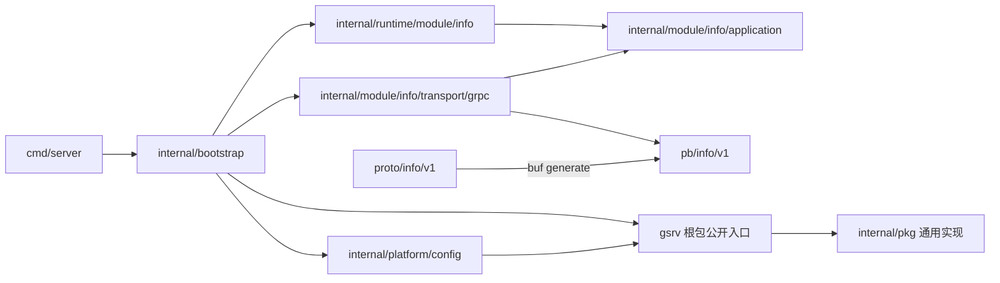
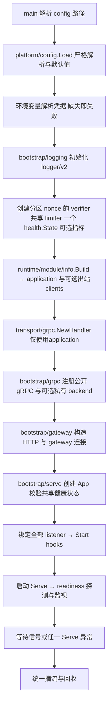
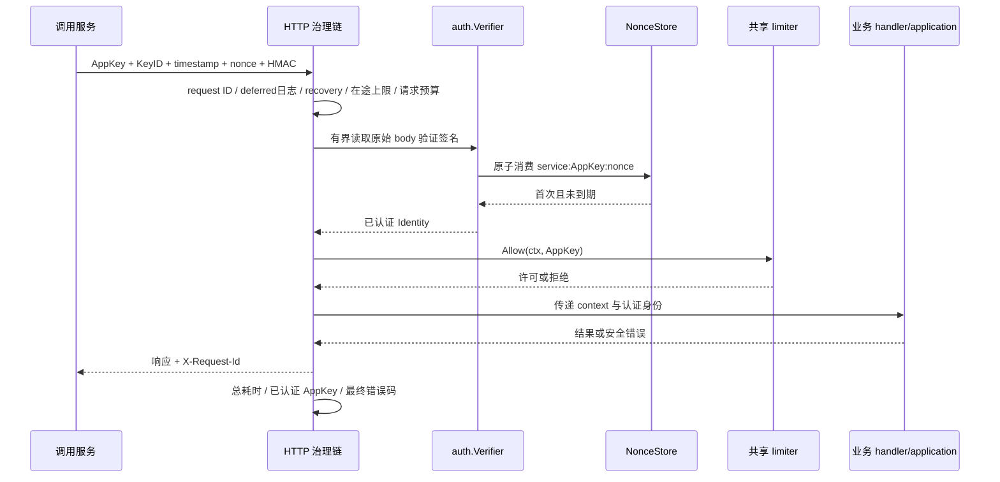
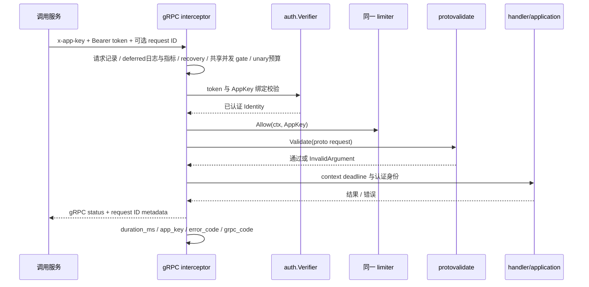
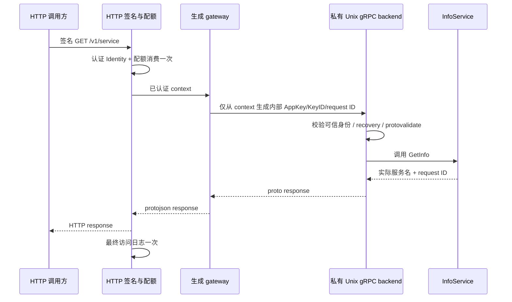
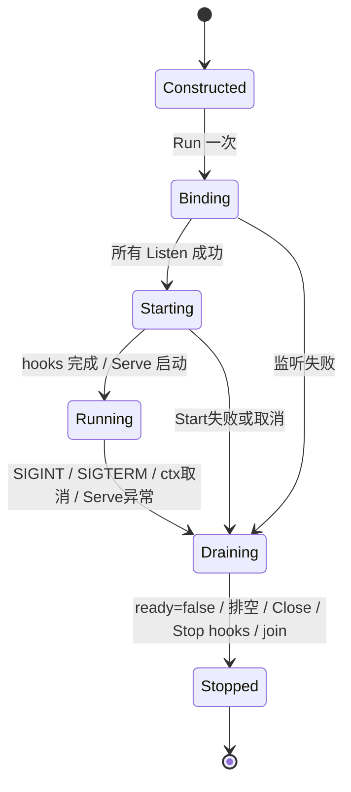
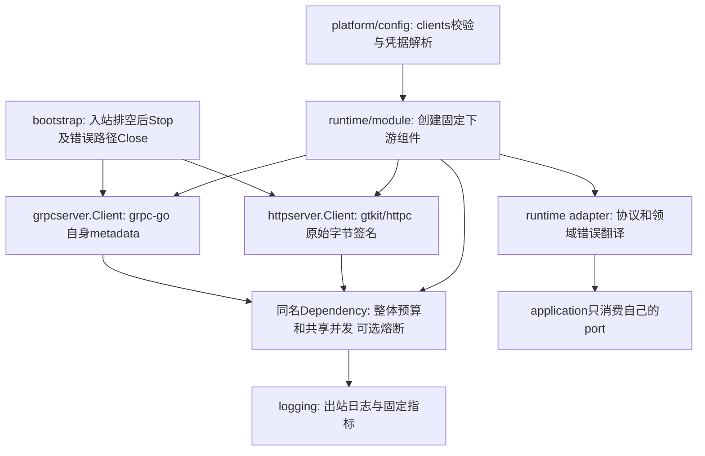

# gsrv 公共骨架实施方案

制定：2026-10-13；验收及复用方式更新：2026-10-14。构建/运行使用 Go 1.27.2 或更新补丁版；go.mod 的 1.27.0 表示语法最低版本，不代表推荐运行补丁版。依据 [HTTP/2 官方漏洞记录](https://pkg.go.dev/vuln/GO-2026-6617)。当前模块：`github.com/gtkit/gsrv`。部署背景：Linux 裸机单实例，无 Kubernetes、Docker 或注册中心。各中台服务通过复制整个项目源码创建独立 Go 模块、独立仓库，公共实现随服务源码维护。OCPC 已按指令移除，以简单 InfoService 验证。真实 QPS、P99、请求大小与未来副本数尚未给出，下文配置是初始示例，不是容量承诺。

## 1. 架构约束与目录

项目生成入口为 `cmd/gsrv`：安装后使用 `gsrv new <项目名> --module <模块路径>`，在新目录生成下述完整服务结构。生成器自带固定版本源码快照，改写 module/import/go_package/配置示例服务名后通过现有 `make gen` 生成 pb；不移动服务模块、不修改依赖方向。安装、工具前提和快照维护命令见 README。生成出的服务不携带生成器自身或本地 agent 工具。

**沿用参考项目 `ocpc-tool-service` 的目录层级与依赖方向。未经用户明确授权，不移动层级、不另设分层。** 删除 OCPC 不代表允许改变架构；`info` 在其原位置替代业务模块。通用实现位于已有 `internal/pkg` 层，根包提供本仓库的通用能力装配入口。

```text
gsrv.go                              本仓库通用能力的装配入口
cmd/server/main.go                   flag 与进程入口
config/env/env.yml.example           外置配置模板
proto/info/v1/info.proto             唯一契约源
pb/info/v1/                          buf 生成产物
internal/
  bootstrap/
    app.go                           配置→日志→入口服务→运行
    logging.go                       日志装配入口
    grpc.go                          runtime 模块→handler→gRPC 注册
    gateway.go                       HTTP/JSON 网关装配
    serve.go                         server 集合、运行和资源回收
  runtime/module/info/factory.go     模块装配
  module/info/
    application/info.go             中立服务信息查询
    transport/grpc/handler.go        proto/application 映射
  platform/config/config.go         服务配置默认值、校验与环境变量引用
  pkg/
    interceptor/                    unary/stream 治理链、错误映射
    requestid/                      request ID、认证身份记录与降级标记
    auth/                           HMAC、token 和 nonce 原子消费
    limiter/                        gtkit/golimit 适配、共享并发 gate
    logging/                        gtkit/logger/v2、访问日志和最小指标
    breaker/                        gobreaker/v2、httpc、降级执行钩子
    health/                         共享就绪状态与依赖检查
    lifecycle/                      Listen/Serve/Shutdown/Close 与信号
    httpserver/、grpcserver/         通用协议 server 封装
    gateway/                        生成 gateway 注册和身份 metadata
    configloader/                   严格单文档 YAML 与凭据环境变量读取
```

`repository → models`、`module/<m>/worker → application` 等原有层级规则继续有效；InfoService 没有持久化和后台任务，因此不生成空仓储、模型或 worker。未来实际业务需要这些能力时，仍放回原有层级。



禁止：application 引用 GORM、具体 repository、渠道 SDK 或熔断器；transport 引用 repository/GORM/SDK；repository、internal/pkg 反向依赖业务模块。根包入口和其 internal/pkg 实现不能引用 InfoService 或 pb。架构传感器检查当前项目；复制后的新服务携带相同检查脚本并保留分层规则。

## 2. 范围与职责

| 能力 | gsrv 的职责 | 服务的职责 |
|---|---|---|
| 进程生命周期 | 信号、监听失败回收、摘流、排空、强制关闭 | 显式注册 servers/hooks，关闭自持资源 |
| 配置 | 严格 YAML、明确环境变量读取 | 在 platform/config 组合配置、补默认值、业务校验 |
| 服务注册 | 接收生成的 gRPC 注册函数，提供 HTTP handler 接口 | 注册本服务契约；下游地址从服务配置读取 |
| 健康检查 | /livez、/readyz、标准 gRPC Health，共用状态 | 注册少量必需依赖 Check |
| 服务调用方认证 | HTTP HMAC/token 校验与身份传递 | 提供凭据，处理终端用户与业务权限 |
| 限流 | 中立 `RateLimiter.Allow(ctx, AppKey)`、两协议共用 | 选择本地/外部实现与实际配额 |
| 熔断 | 指定下游的状态机、可配置失败分类 | 在 runtime adapter 中界定依赖和错误分类 |
| 降级 | allow/fallback 执行钩子、剩余预算、degraded 标记 | 决定是否允许降级、数据来源和结果 |
| 日志 | 请求 ID、耗时、已认证 AppKey、最终错误码 | 业务上下文日志与安全文案 |

服务注册中心当前不引入：同机/内网服务用静态地址和服务配置；gRPC 注册是进程内契约装配。未来需要动态发现时再按明确需求接入，不提前加入空 registry 抽象。验证码规则、推送路由、文件权限、身份授权等均不属于骨架。

## 3. 依赖复用

| 依赖 | 锁定版本 | 用途 |
|---|---|---|
| gtkit/logger/v2 | v2.3.0 | 唯一日志实现，显式控制台输出 |
| gtkit/encry | v1.3.0 | HMAC-SHA256 原语 |
| gtkit/golimit | v1.0.8 | 本地令牌桶 |
| gtkit/httpc | v1.5.0 | 有超时的出站 HTTP client |
| gtkit/json/v2 | v2.0.7 | 普通 HTTP 安全错误 JSON |
| grpc-go | v1.83.2 | server、health、metadata 与 status |
| grpc-gateway/v2 | v2.30.0 | proto HTTP/JSON 桥接 |
| buf.build/go/protovalidate | v1.2.0 | 统一 unary/RecvMsg 校验 |
| sony/gobreaker/v2 | v2.4.0 | gtkit 现有依赖没有提供所需熔断封装，新增状态机底座 |
| yaml.v3 | v3.0.1 | 既有严格配置加载 |

既有 gtkit 版本保持锁定，不升级 major；安全扫描确认后将 grpc-go 从 v1.83.0 升为修复版 v1.83.2、x/net 从 v0.57.0 升为 v0.60.0，并同步其所需 x/sys v0.48.0、x/text v0.42.0。修复依据见 [gRPC 官方漏洞记录](https://pkg.go.dev/vuln/GO-2026-6443)、[HTTP/2 官方漏洞记录](https://pkg.go.dev/vuln/GO-2026-6617)。

gobreaker/v2 是所用依赖的模块路径，不是将 gsrv 发版为 v2。公共骨架不强制数据库、Redis、消息队列。OCPC 专属 ocpcx、asynqx、redisx、asynq、go-redis、miniredis 已清理。未来实际需要 Redis/DB 时优先 gtkit/redisx、gtkit/ormx，仍由服务自身装配。

## 4. 组件装配流程



构造函数不启动背景 goroutine、不绑定监听。每个公开协议至少有认证器；空凭据不能用来关闭鉴权。HTTP/gRPC 使用同一 verifier、同一 limiter 和同一健康状态。InfoService 由 runtime 构造，handler 只映射服务名和框架注入的 request ID。

私有 gateway 连接由 bootstrap 持有，应用排空后关闭；日志最后 Sync。监听任一端口失败，已创建的 listener 回收，ready 保持 false。hooks 是显式后台组件；Start 即使部分失败也必须可 Stop，Stop 必须遵守总关闭 ctx。

## 5. 请求时序

### HTTP 原生 handler



认证失败不消耗调用方 QPS 配额。全局在途上限先于认证，以限制入口负载；触达该上限的请求尚未认证，日志 app_key 为空。探针不走业务认证/配额和访问日志。

### gRPC



stream 建连时认证与限流一次，每次 RecvMsg 校验。grpc.max_inflight 默认100，是每个公开 server 跨连接的 unary/stream 合计并发，stream 持有至结束；满时立即 ResourceExhausted，所有已获槽位的退出路径释放。max_concurrent_streams 仍是每连接限制。健康检查不走业务鉴权、QPS、并发和参数校验，私有 gateway 不重复消耗并发或指标。长期流不强制套用 unary 的3s预算；消息额度与背压由服务按实际场景设计。

### proto HTTP gateway



gateway 禁止把客户端 `Grpc-Metadata-*` 或内部身份头直接映射进 metadata；私有 backend 只能监听 Unix socket，父目录必须仅服务用户可访问（0700），socket 0600。公开 gRPC 始终验证 token，不信任私有身份头。单机部署使用独立系统用户保证进程隔离；持有相同系统用户权限的进程处于该信任边界内。

## 6. HTTP 签名契约

单值头：`X-App-Key`、`X-Key-Id`、`X-Signature-Timestamp`（Unix 秒）、`X-Signature-Nonce`、`X-Signature`（标准 Base64，严格编码）。服务名、AppKey、KeyID、nonce 均为 1–64 位 ASCII 字母、数字、点、下划线、短横线。secret 至少 32 字节，不发送到网络。

按以下顺序以换行拼接，末行后不补换行：

```text
gsrv-hmac-v1
目标服务名
AppKey
KeyID
HTTP method
URL.EscapedPath()（空则 /）
URL.RawQuery（保持原始顺序）
Content-Type（原值，未设置为空）
Unix 秒字符串
nonce
SHA256(原始 body) 的小写十六进制
```

计算 `Base64(HMAC-SHA256(secret, canonical))`，使用常数时间比较。校验原始字节后恢复 body，后续 JSON 解码不得先于签名。默认时间容差前后 30s，允许配置正值且不超过 5m；维护系统时钟同步。缺少、重复身份头、过期、篡改、method override 和重放均拒绝。

使用 `gsrv.SignHTTP(request, serviceName, credential, time.Now(), rand.Text())` 生成签名。每次重试用新 nonce；它不自动重试。Content-Type首尾SP/HTAB按net/http发送规则裁掉后参与签名，按最终发往服务的 URI 签名，代理不得静默改写 path/query/content type/body。helper 限定 body 为 1MiB；大文件宜独立设计分片/对象存储直传与上传凭证，不将无限大内容读入内存。

默认 verifier 的 nonce_capacity=100000，nonce_capacity_per_app_key=0 按不同 HTTP AppKey 向下均分。正份额不得超过均分值，KeyID 轮换共用份额；不足以给每方至少一项时启动报错。单方满时429，其他 AppKey 仍可消费自身份额；普通存储/全局故障503，取消/超时按统一错误契约映射。只回收到期项，不驱逐有效nonce。合法签名在QPS判断前消费nonce，后续429仍保留记录防重放。

只有带HTTP secret的AppKey参加分配。自定义NonceStore负责自身原子去重、有效期和等价隔离；显式注入原始NewMemoryNonceStore(capacity)只有全局容量，不自动得到默认verifier的预留策略。nil/零值MemoryNonceStore在构造时拒绝。内存不跨重启/副本共享，本轮不引入Redis。默认前后30s窗口的最长保留约61s，容量按实际签名QPS乘最大保留时间并留余量；等份隔离可能留有空闲容量。

gRPC 使用绑定 AppKey 的32–4096字节token与TLS；认证构造器、入出站配置与验证器采用相同长度约束。不对 protobuf 重新序列化后做同一 HTTP body 签名，以免出现规范化差异。token 可以按同 AppKey 多 KeyID 并行配置进行轮换；QPS 仍按 AppKey 汇总。

## 7. 限流、熔断与降级

本地限流适配锁定的 golimit v1：namespace + 已认证 AppKey，初始 burst=QPS。示例 QPS=100；缺省 0 明确关闭，负数非法。HTTP 与公开 gRPC 必须注入同一实例；更换 KeyID 不新增额度。达到限额 HTTP 429（配额拒绝带 Retry-After: 1）、gRPC ResourceExhausted；limiter 故障 fail-closed 为 503/Unavailable。

golimit v1 有进程全局 registry/清理 goroutine，没有实例 Close API；namespace 必须隔离服务/测试实例，生命周期按进程管理，不为新增 Close 升级 major。配额只在单进程共享，不宣称多副本全局额度。

每个外部依赖用独立 breaker，由 runtime adapter 持有。默认：统计窗口 30s、开启 10s、至少 20 个完成样本、失败比例 >=0.5、半开允许 1 请求。取消、参数错误、鉴权/权限拒绝不计依赖失败；业务通过 IsSuccessful/IsExcluded 补充领域分类。

`gsrv.RunDependency` 的 operation 与 fallback 共用正的总预算，不延长调用方 deadline，不自动重试。只有显式 `allow(err)` 为 true 且 fallback 非空才执行降级；取消、预算耗尽、鉴权与参数错误直接返回。fallback 内容归业务；成功降级标记 `degraded=true`。未提供 fallback 保留原错误，骨架不返回虚假的成功结果。`gsrv.NewHTTPClient` 复用 httpc 并要求正的客户端超时。

## 8. 生命周期与资源顺序



1. App在构造时采用未显式指定的server HealthState，或校验显式状态与全部健康感知server一致；错配、nil/typed-nil server和未初始化状态在监听前报错。旧Wrap/自定义server未提供状态时仍由装配方负责。随后绑定监听和启动组件，ready=false。
2. 启动Serve，首次Refresh后托管每1s背景刷新；两协议读取同一快照。无检查时可直接就绪，有检查时首次探测前未就绪。
3. 收到关闭请求，立即 ready=false，取消监视器。
4. 从未取消的上下文创建**一个总关闭预算**，默认 20s。依注册顺序 HTTP → 公开 gRPC → 私有 gRPC，先让 HTTP 在途 gateway 调用完成。
5. HTTP Shutdown 超时强制 Close；gRPC GracefulStop 超时 Stop 并等待返回。
6. 取消后台 worker context，逆序 Stop hooks；等待 server/monitor goroutine 退出。
7. bootstrap 关闭自持 gateway 连接，最后 logger.Sync。

Start 在启动期须可取消并及时返回，Stop/Check/业务调用都必须遵守 ctx。Go 不能安全强杀不配合的任意业务函数；骨架不会为超时另起不受控 goroutine。App 不可并发/重复运行，需重新构造。致命错误在 main 收到清理后的返回值才记录，禁止 Serve goroutine 调 Fatal。

/livez仅表示存活；/readyz与gRPC Health整体空服务名只读同一缓存，不按请求重复探测。每项Check的ctx上限1s，必须合作式取消；快照有调度与探测耗时的延迟。激活后禁止AddCheck，重复SetReady(true)保留已有快照。关闭立即false，生命周期版本阻止旧探测覆盖重新激活后的状态；探测panic被恢复并发布未就绪。Refresh的串行等待可被ctx取消，不起无法回收的超时goroutine。手工使用关键Check时先Refresh再托管Monitor，App已自动执行。

## 9. 配置与日志核对

`config/env/env.yml.example` 是当前项目的配置示例；真实 YAML 从该示例复制，不保留 OCPC 的旧配置。新服务在自己的仓库同步维护配置读取、默认值、约束、示例与说明。缺失协议块关闭该协议，至少启用一个公开协议；不要用环境名称推断功能开关。

| 字段组 | 默认/回落 | 约束与作用 |
|---|---|---|
| name | 无默认，必填 | 服务名与 HMAC 目标必须一致 |
| shutdown_timeout | 0/缺省=20s | 正值，小于 systemd TimeoutStopSec |
| http.addr | 127.0.0.1:8080 | 非 loopback 需要成对 TLS 文件 |
| http.read_header_timeout/read_timeout | 5s/10s | 正值，限制入站读取 |
| http.write_timeout/idle_timeout | 15s/60s | 正值，write >= request_timeout |
| http.request_timeout | 3s | 合作式处理预算，不延长上游 deadline |
| http.max_body_bytes/max_inflight | 1MiB/100 | 正值，控制单体和入口并发 |
| grpc.addr/network | 127.0.0.1:9090 / tcp | tcp 或 unix；私有 backend 固定 unix |
| grpc.cert_file/key_file | 空 | 同时设置；跨主机 TCP 必填 |
| grpc.request_timeout | 3s | unary 预算，不施加到长期 stream |
| grpc.max_recv_bytes/max_send_bytes | 1MiB/1MiB | 正值，双向消息大小限制 |
| grpc.max_concurrent_streams | 100 | 每连接上限，非全进程/逐消息限流 |
| grpc.max_inflight | 0/缺省=100 | 正值，公开server跨连接unary/stream总并发，健康/私有backend跳过 |
| grpc.reflection | false | 调试服务，启用后仍走 stream 鉴权 |
| gateway_socket | 空关闭 | 非空要求 HTTP；私有父目录，路径相对 cwd |
| rate_limit_qps | 0 关闭 | 非负，每 AppKey 双协议合计本地配额 |
| auth.nonce_capacity | 0/缺省=100000 | 正值，全局有效nonce容量，不少于不同HTTP AppKey数 |
| auth.nonce_capacity_per_app_key | 0 自动均分 | 非负，正值不超过均分值，KeyID轮换共用 |
| metrics.enabled | false | 启用要求HTTP，GET /metrics仅直连loopback可读取 |
| keys.app_key/key_id | 必填 | 安全标识，同 AppKey/KeyID 不重复 |
| keys.secret_env/token_env | 无默认 | HTTP/公开gRPC 启用时相应必填，环境值至少32字节 |
| log.level/json | info/false | level 为 debug/info/warn/error；生产示例 JSON=true |
| log.path/console | 空/true | 文件路径空关闭文件；不可关闭所有输出 |

AuthConfig的时间窗及breaker参数仍由代码显式装配；nonce容量、gRPC总并发及最小指标已同步到当前项目的配置示例。

访问日志固定字段：`request_id`、`service`、`protocol`、`operation`、`duration_ms`、`app_key`、`error_code`、`degraded`，另带 `http_status` 或 `grpc_code`。error_code 统一大写下划线；grpc_code 保留协议原名。尚未认证时 app_key 为空，不信任伪造头。HTTP operation 优先 handler 路由 Pattern，缺失时记录 method+escaped path，不记录 query/body/token/secret/签名；不要在业务 URI path 中放凭据。日志使用 logger/v2 的上下文字段与显式 console 配置；配置非法/目录不可写在启动期报错。panic、配额拒绝、鉴权失败都输出最终访问记录；健康探针和私有 gateway backend 不重复记录。

## 10. 独立服务开发与 Linux 部署

指标通过现有 `internal/pkg/logging` 实现、根包导出，使用标准库输出 Prometheus 0.0.4，无新依赖、全局注册器或后台任务。HTTP/gRPC 注入同一个 Metrics；nonce 占用绑定 verifier.NonceStats；下游breaker通过 BreakerConfig.Metrics 注册固定安全且唯一名称，最多64项。InfoService无下游，不创建虚构熔断器。

| 指标 | 类型/含义 | 有界标签 |
|---|---|---|
| gsrv_requests_total / gsrv_errors_total | 完成请求/错误计数 | service、protocol=http/grpc |
| gsrv_request_duration_seconds | 固定桶耗时，秒；stream为整个调用 | service、protocol、le |
| gsrv_inflight | 已获并发槽位的调用数 | service、protocol |
| gsrv_limiter_rejections_total | QPS/并发保护拒绝计数 | service、protocol、reason=qps/inflight |
| gsrv_nonce_entries / gsrv_nonce_capacity | 尚未到期总占用/全局容量 | service；非内存自定义存储不冒充零占用 |
| gsrv_breaker_state | 0=closed、1=half-open、2=open | service、装配的固定dependency |

耗时桶为0.005/0.01/0.025/0.05/0.1/0.25/0.5/1/2.5/5/10/+Inf。统计范围是进入HTTP治理handler或gRPC interceptor的调用；gRPC之前的连接、解码、未知方法错误不计入。健康、抓取及私有gateway不重复计数，长stream与unary在grpc协议桶中汇总。

metrics.enabled缺省false；启用时HTTP保留GET /metrics，只允许RemoteAddr的IPv4/IPv6 loopback来源，忽略转发头，远端403。抓取绕过业务签名/nonce/QPS/指标。本机采集器可使用静态127.0.0.1:8080目标和15s周期；本机反向代理须限制管理路径的外部转发。gRPC-only服务如需该示例抓取路由，应同时启用HTTP。

创建新服务时复制整个项目源码，保留 InfoService 的现有分层和所有通用实现；新仓库通过自己的根包装配内部公共能力，不额外依赖外部 gsrv 模块。创建步骤如下：

1. 复制源码到新目录并建立独立 Git 仓库，排除 `.git`、`bin`、`run`、`logs`、真实配置、凭据和证书私钥。记录来源骨架的提交，避免复制已有服务的业务数据或运行产物。
2. 将 `go.mod` 的 module 改为服务实际仓库路径。例如验证码服务演示路径可用 `go mod edit -module=example.com/sms-service`；实际使用须换成自己的路径。
3. 将 `cmd`、`internal`、`gsrv.go` 中的自模块 imports（包括测试）和 proto `go_package` 同步改为新路径。架构传感器自动读取当前module；保留gtkit等依赖，不改检查器中用于识别旧骨架的常量，禁止全局替换第三方路径。
4. 执行 `GOWORK=off make gen` 和 `GOWORK=off go mod tidy`，通过契约重新生成 pb，禁止直接改生成产物。
5. 在 `config/env/env.yml.example` 和真实配置同步调整 `name`、HTTP/gRPC端口、gateway socket和凭据环境变量引用；改名副本须替换example-service。`name`与调用方HMAC目标一致；同机服务需要不同监听端口和独立运行目录。
6. 按 proto → application command/result/ports → runtime adapters → transport 映射 → bootstrap 注册开发验证码/推送/文件/身份模块；业务规则不放进通用封装，目录层级保持不变。
7. 执行 `GOWORK=off make check`、`make build` 并验证实际接口。公共能力修复不会自动更新已有服务，应逐服务同步源码并验证，不用再次覆盖整个仓库。

Linux/amd64 构建：`make build`，输出 `bin/server`。以下 systemd 使用样例保留在本文中，不另建部署目录。以 sms-service 为示例名称，安装时替换用户、目录、配置及单元名称；实际配置设置 `name: sms-service`、`gateway_socket: /run/sms-service/gateway.sock`，远程 HTTP/gRPC 地址需配置 TLS。`shutdown_timeout` 缺省20s，必须小于下方 `TimeoutStopSec=30s`。`secrets.env` 由部署负责人以0600权限配置，包含配置所引用的环境变量；日志启用 console 交由 journald 收集。

```ini
[Unit]
Description=sms service
After=network-online.target
Wants=network-online.target

[Service]
Type=simple
User=sms-service
Group=sms-service
WorkingDirectory=/opt/sms-service
ExecStart=/opt/sms-service/bin/server -config /etc/sms-service/env.yml
EnvironmentFile=/etc/sms-service/secrets.env
RuntimeDirectory=sms-service
RuntimeDirectoryMode=0700
Restart=on-failure
RestartSec=3s
KillSignal=SIGTERM
TimeoutStopSec=30s
NoNewPrivileges=true
UMask=0077

[Install]
WantedBy=multi-user.target
```

容量先以入口有界为目标：单请求 1MiB、同时100请求的原始 body 理论上限约100MiB，解析与桥接还会额外分配，需实测而非把该值当进程内存上限。实际容量估计使用 `并发≈QPS×平均耗时(秒)`；100QPS、平均100ms约10个在途请求。P99、慢依赖、上传场景须压测后决定预算/并发/配额，不把示例100当真实需求。不要同时放宽 body 与并发而忽略内存。

## 11. 实施与验收

| 阶段 | 实施内容 | 可观察验证 |
|---|---|---|
| 基线 | module/Go版本对齐，清理 OCPC 专属依赖 | go mod tidy、go build |
| 公共骨架 | 原 internal/pkg 位置实现 lifecycle/config/health | 监听失败回收、hooks、取消、探针、严格 YAML |
| 请求治理 | HMAC/nonce/token/limiter/request ID/errors/logs | 篡改/过期/重放、并发nonce、AppKey隔离、拒绝/panic日志 |
| 稳定性 | gtkit/httpc与gobreaker、显式降级钩子 | closed/open/half-open、失败分类、共享预算、取消无降级 |
| 服务验证 | 原层级 info 模块 | 实际 GetInfo HTTP/gRPC、返回真实服务名/request ID |
| gateway | 私有 socket 身份通道、配额一次 | 伪造客户端内部头无效、HTTP/gRPC同配额 |
| 交付 | 文档/配置/systemd说明/门禁同步 | make check、Linux构建；依赖调整时执行漏洞检查 |

`make check` 包含当前项目的build/lint/vet/race/go fix -diff/架构传感器及proto-check/copy-check。CI执行相同检查和make build。真实协议测试只在本机临时端口/socket，凭据为测试生成值；不触达媒体、DB、Redis或生产。Linux交叉编译验证目标平台；复制的新服务在自己的仓库执行相同门禁。

OpenSpec 按任务记录执行并严格校验，完成后归档合并 spec。回滚是恢复本次源码、配置与依赖，不涉及持久化迁移。交付结果以实际检查日志为准；不可达的外部漏洞库须明确报告，不能将未完成扫描写为通过。

## 12. 验证记录

2026-10-14 此前复审发现工作区已回到前五项实施前，49项文件被仅从Git索引移除但磁盘仍存在且等于HEAD；.gitignore的交付例外也被移除。该次复审备份索引后只撤销暂存删除、恢复例外，没有移动、删除或覆盖未授权文件。不能仅凭status判断取消跟踪/回退的操作者；旧前五项归档正文在当前工作区缺失，仅残留元数据，恢复与复审使用新的review-runtime-protection-regressions变更完整记录。

该次复审恢复五项能力并修正边界：typed-nil与未初始化健康/内存nonce存储构造拒绝；重复就绪保留快照；旧生命周期探测不覆盖新周期；探测panic未就绪；等待Refresh可取消；Health跳过业务参数校验；认证/参数失败、错误、panic及真实stream取消均释放并发槽位。

此前复审中，根服务完整make check通过（lint=0 issues、vet/race/现代语法/架构/buf lint），原目录及依赖锁定版本、proto/pb不变，Linux/amd64构建通过。真实CLI仅用本机临时配置/假凭据验证HTTP A=200/429、B=200、探针200、gateway指标只计一次、gRPC GetInfo成功及SIGTERM exit=0。根服务govulncheck为0项可达漏洞，既有CEL导入包提示如下。以下属于历史验证，不表示本轮重新执行了漏洞扫描或CLI验证：

- 根服务的 `make check`：build、golangci-lint（0 issues）、vet、race、go fix -diff、架构传感器与 buf lint。
- 根服务 Linux amd64 交叉构建。
- proto 再生成结果与入库产物逐文件 SHA256 一致，未手改 pb。
- 真实 main 进程 `/readyz=200`，发送 SIGTERM 后退出码 0；默认 path 留空的控制台日志已加入回归测试。
- 根服务 `govulncheck`：0 项可达漏洞；另有 1 项导入包提示：cel-go v0.28.0 的 NativeTypes/ParseStructTag（当前调用图未使用），保留现有 protovalidate 依赖约束，未宣称全部依赖无漏洞。未来采用这两个 API 时需先升级至修复版本 v0.30.0 或更高，依据 [GO-2026-6094](https://pkg.go.dev/vuln/GO-2026-6094)。
- 目录核对：根项目沿用原服务分层；通用实现集中 internal/pkg；手写测试与对应实现同目录；全部 Go 文件 gofmt -l 无输出。

2026-10-14 整仓复制方式清理：已移除重复的独立服务起始目录及检查/构建调用，根文档同步整仓复制流程，systemd样例保留在本文。其余目录层级、Go源码、配置示例、锁定依赖及根proto/pb保持不变。实际运行 `GOWORK=off make check` 全部通过：build、golangci-lint（0 issues）、vet、race（count=1、timeout=5m）、go fix -diff无输出、架构传感器与buf lint；`make build` 生成Linux amd64静态二进制。另通过bash语法检查、有效模板引用/文档链接核对和git diff --check。受保护根文件哈希、目录集合、既有暂存diff均与操作前一致，本次29个已跟踪删除均属于授权目录。OpenSpec继续本地不跟踪，变更严格校验通过；本轮无依赖变更，未重新执行漏洞扫描。

本轮不进行 Git 提交、push、tag、Release、容器或生产部署。

## 13. 出站调用与复制门禁（2026-10-14）

本阶段沿用所有现有目录：HTTP客户端在internal/pkg/httpserver/client.go，gRPC客户端在grpcserver/client.go，共享Dependency在breaker/dependency.go，出站观测在logging/outbound.go，TLS工具在configloader/tls.go。platform/config处理服务级配置组合和环境变量引用；runtime/module/info/factory.go装配可选资源，bootstrap仍只负责进程编排和关闭。根gsrv.go提供类型和构造入口，不承载业务规则。



InfoService不增加下游业务调用，不因配置clients而自动发请求或执行降级。客户端构造只准备资源；gRPC建连惰性进行。关键依赖是否影响readiness仍由模块显式注册Check，配置一个客户端不等于自动将它设为关键依赖。

配置缺省`clients: {}`，最多64个固定安全名称；每项可启用HTTP、gRPC或两者。各协议共用一个Dependency，不能为两个协议分别创建同名保护后声称总并发共享。字段、默认值与关联如下，完整可启用示例见根`.example`注释块：

| clients.<name>字段 | 用途与缺省/约束 |
|---|---|
| app_key | 本服务访问此下游的身份，必填安全标识；不转发入站AppKey |
| key_id | HTTP签名版本，HTTP必填安全标识；仅gRPC可空 |
| secret_env/token_env | HTTP/gRPC凭据变量名，对应协议启用必填合法环境变量引用；secret至少32字节，token为32–4096字节，与认证器上限一致 |
| protection.timeout | 完整调用含stream预算；0/缺省3s，必须正，不延长caller deadline；长期stream显式调大 |
| protection.max_inflight | 此依赖HTTP/gRPC合计在途；0/缺省100，必须正；满时立即失败 |
| protection.circuit_breaker | 缺省false；开启沿用30s窗口、至少20样本、失败比0.5、开启10s、半开1；代码可提供BreakerConfig的阈值/分类 |
| http.service/base_url | 必填HMAC目标名与固定http(s) origin；目标名与对方name一致，origin无用户/路径前缀/query/fragment，HTTP仅loopback |
| http.ca_file | 额外服务器CA路径，相对cwd；空使用系统信任，HTTP必须空 |
| http.max_request_bytes | 已编码签名请求体；0/缺省1MiB，范围(0,1MiB] |
| http.max_response_bytes | 解压后响应读取；0/缺省10MiB，正且<MaxInt64，超限不给body |
| http.max_idle_conns_per_host | 空闲连接保留；0/缺省10，正且不超过总连接上限 |
| http.max_conns_per_host | 总连接数；0/缺省100，正，等待受整体预算限制；HTTP/2连接数不等于调用并发 |
| grpc.target | 静态host:port，端口1–65535；不接入注册中心或远端service config |
| grpc.plaintext | 缺省false使用TLS；true仅loopback/localhost，CA/server_name必须空 |
| grpc.ca_file/server_name | CA空使用系统信任，server_name空使用target host；保持服务器证书验证 |
| grpc.max_recv_bytes/max_send_bytes | 单条消息限制，0/缺省各1MiB，必须正；单次CallOption不能放宽配置上限 |

HTTP调用固定origin、不跟随重定向、不使用环境代理；每次框架调用生成新timestamp/nonce，对最终URI、规范化后的Content-Type和原始body字节签名。输入headers被复制，Authorization、Proxy-Authorization、Cookie、签名、私有gateway与旧request ID字段重写或剔除；使用本服务配置身份，不沿用上游调用方身份。`.Do(ctx, method, path, body, headers)`的path以/开头，可含query；body在调用期间由调用方保持不变。非2xx保留状态/header/有限body供runtime adapter翻译，同时返回安全公共错误；网络与响应读取错误不向访问日志输出URL/body/原始错误。响应体总会关闭。

已签名请求清除GetBody，避免net/http在复用连接上遇到不确定断连时自动重发GET或带幂等键的POST，复用已消费nonce。连接池继续复用；框架不根据状态码/网络错误执行业务重试，也不自动添加幂等键。底层确认未发送/未处理时可能恢复连接，仍共用原预算；此约束不承诺网络层只有一次尝试，也不提供跨服务恰好一次执行保证。显式业务重试由runtime adapter决定，必须重新生成签名与nonce。

在runtime adapter内使用已装配组件的调用片段如下（应用层仍使用自身port）：

```go
response, err := components.HTTPClients["peer"].Do(ctx, http.MethodGet, "/v1/service", nil, nil)
if err != nil {
    return fmt.Errorf("read peer information: %w", err)
}
// 在adapter内把response.StatusCode/Header/Body翻译为application结果。

client := infov1.NewInfoServiceClient(components.GRPCClients["peer"])
result, err := client.GetInfo(ctx, &infov1.GetInfoRequest{})
if err != nil {
    return fmt.Errorf("read peer information: %w", err)
}
// 在adapter内把result翻译为协议无关的application结果。
```

gRPC wrapper实现ClientConnInterface，使用自己的AppKey/token与有效request ID，保留调用方其他metadata但清理Authorization、Proxy-Authorization、Cookie和已知身份/私有gateway字段，输入metadata不修改。禁用策略/业务重试及resolver service config，不自动延长caller deadline。WithDisableRetry不关闭grpc-go对未发送/未处理RPC的透明重试，透明尝试共用原预算与同一并发槽位，依据[官方说明](https://pkg.go.dev/google.golang.org/grpc#WithDisableRetry)及锁定v1.83.2源码；不使用私有API伪造关闭承诺。下游gRPC错误保留协议code但使用安全文案；公共治理code用于统一指标/熔断分类。

unary结束即归还容量。客户端流（ServerStreams=false）的单个成功最终响应即结束，兼容生成客户端CloseAndRecv，不需再次Recv EOF；服务端流/双向流仍保持到Recv EOF/错误。取消、预算到期或Close即使caller不再Recv也由watcher回收，只计量/释放一次。CloseSend和SendMsg EOF只表示发送侧关闭，不能判完整调用成功；caller需读取最终状态或取消。watcher由客户端持有，Close拒绝新调用并等待在途与watcher退出。

共享Dependency不默认排队或重试、不自动降级；可选熔断使用现有gobreaker/v2的TwoStep机制，在完整调用结束时报告。取消、参数、鉴权/权限错误排除；上游ctx预算耗尽也排除下游失败样本，但调用返回与指标仍保留DeadlineExceeded，下游自身timeout到期继续计为失败。WithTimeoutCause使用每次调用独立标识记录最先触发的来源，下游先超时不会因finish较晚、上游随后也到期而被误排除。上游导致调用结束时，report额外携带context.Canceled，供公共排除分类识别；自定义分类须用errors.Is识别包装错误。NotFound等业务拒绝不当作下游不可用。调用自身的并发/熔断拒绝不计进熔断失败样本。HTTP整体预算覆盖响应body读取，unary和整个stream也使用min(caller剩余预算, dependency.timeout)。仍需业务降级时在runtime adapter明确使用既有allow/fallback钩子，不叠加默认重试或重复保护。

出站访问日志字段包含direction=outbound、dependency、protocol、request_id、自己的app_key、duration_ms、error_code。最小指标新增gsrv_dependency_requests_total（固定公共error_code）、errors_total、inflight、rejections_total（inflight/breaker）、duration_seconds（复用既有桶）。仅装配期注册的最多64个目标参与导出，不将URL、AppKey、request ID、body或任意错误文案作为标签；入站指标不重复计入出站。

契约门禁`make proto-check`在自建临时目录生成并比较整个pb集合，覆盖缺失、额外和过期文件，不改工作区，不用Git是否干净判断生成正确性。复制门禁`make copy-check`动态读取go.mod，检查手写自身imports、proto go_package及配置.example的服务名/监听/socket；新module需替换example-service。`bash scripts/check-copy.sh /本机/另一个服务源码目录`显式比较两个示例的标识冲突，数值端口和等价IP字面量归一比较，不扫描其他仓库、不读取真实配置或凭据，不保证实际目标机端口空闲。架构传感器使用当前module且保留原禁止规则。CI与make check统一执行这些入口，buf和本地插件复用现有安装，首次依赖缓存缺失可能访问Buf源。

本阶段实际验收（2026-10-14）：完整`GOWORK=off make check`通过，包含build、lint（0 issues）、vet、race（count=1、timeout=5m）、go fix -diff无输出、架构、临时proto/pb比较及复制检查。`make build`生成Linux amd64静态二进制。所有真实协议验证使用本机测试服务和假凭据，未连接生产或外部业务系统。

- HTTP真实验签覆盖原始body/escaped path/raw query/Content-Type，入站身份不能替换自己的凭据，request ID透传，新nonce与连接复用；失败不重试、重定向不跟随、超大响应/非法目标拒绝、Close取消并归还共享容量，TLS自定义CA验证通过。
- gRPC生成客户端真实unary与stream验证覆盖自身metadata、失败只调用一次、协议错误文案隐藏、stream保持槽位、CloseSend不提前归还、EOF/取消/Close回收，以及TLS证书名称校验。回审补齐单次CallOption不能放宽消息上限的unary/stream反证。
- 共享Dependency覆盖HTTP/gRPC合计容量、并发重复finish只计量一次、取消/参数/身份错误分类、可选熔断；synctest覆盖caller deadline不延长、超时后不能假成功。有界出站指标覆盖并发抓取、固定错误码收敛与64目标上限。
- 默认.example仍无下游；注释块启用后全部字段可加载，非法参数/未知retry字段/缺失凭据失败。runtime资源关闭、错误装配和InfoService原行为回归通过。
- 真实整仓副本改module/import/go_package及服务标识后，生成、proto/copy/架构门禁和独立构建通过；向改名副本通用包注入业务import后被传感器拒绝。pb过期、额外、缺失三项各自独立反证失败且文件哈希保持，复制标识冲突单元测试通过。
- 全部原目录集合、go.mod/go.sum及原proto/pb哈希与实施前一致；无文件移动/删除/暂存变更。新文件均位于现有包和scripts目录，templates未恢复，OpenSpec保持本地忽略。

调用方回审：bootstrap→runtime.Build改用Components并接入Stop/Close，grpc装配使用同一application；platform.Load解析clients与自身凭据；协议wrapper所有结束分支归还Dependency，生成客户端使用ClientConnInterface。未新增业务规则或依赖，业务重试默认关闭。本阶段未重新扫描漏洞数据库，先前扫描属于历史记录。

### 13.1 出站五项复审与修复记录（2026-10-14）

本次先从干净Git工作区复审，在现有包内补充失败反证再修复。没有调整目录、层级或依赖方向，没有引入业务规则、依赖或默认业务重试。

| 发现 | 修复与反证 |
|---|---|
| Content-Type首尾空白在发送时裁掉，HMAC签名仍使用旧值；代理授权可被转发 | 签名前规范化SP/HTAB，HTTP/gRPC清理代理授权与Cookie；真实对端验签、混合大小写头/metadata、自身身份与trace/request ID保留、输入不变 |
| 复用HTTP连接的响应前断连触发GET及带幂等键POST自动重发，重复同一nonce | 签名后清除GetBody；真实对端验签消费nonce后断连，断言只收到一次请求；正常连接复用和503/重定向边界仍通过 |
| 客户端流的最终成功响应未立即释放槽位，生成CloseAndRecv不会继续Recv EOF | 以ServerStreams区分流类型；真实客户端流单响应即回收，双向流多次响应仍占用容量直到EOF |
| 上游短预算错误计入下游熔断；延迟finish时可能丢失最先触发来源 | 每调用独立WithTimeoutCause区分来源；synctest覆盖上游短预算、自身短预算、两个deadline先后到期及嵌套Dependency；返回/指标仍保留DeadlineExceeded |
| token构造/配置只检查最小长度，与认证器4096字节上限不一致 | 入出站配置、认证构造器与客户端统一32–4096；31/32/4096/4097边界与合法token实际认证验证 |
| 文档错误宣称关闭gRPC透明重试 | 按官方说明和锁定源码校正：策略/业务重试及远端service config关闭，未发送/未处理RPC的透明尝试仍共用原预算/容量 |
| 复制检查对端口/IP做文本比较，等价文本漏报冲突 | 数值端口与net.IP.Equal比较；前导零端口、压缩IPv6、IPv4映射IPv6、通配符与socket冲突回归 |

额外真实协议验证覆盖：停止Recv后主动取消、caller/dependency预算到期与16个并发Close均自动回收，跨协议容量可重新使用且结束指标只计一次；HTTP响应头已返回但body阻塞仍受总预算限制；真实unary短预算仍只进入handler一次。既有健康、nonce份额隔离、公开gRPC准入与gateway回归全部保持。

最终`GOWORK=off make check`通过：build、golangci-lint（0 issues）、vet、全仓race（count=1、timeout=5m）、现代语法、架构、proto/pb临时比较和整仓复制检查。Linux amd64静态`make build`通过，`go mod verify`为all modules verified；`govulncheck`扫描最终调用图为0项可达漏洞，仍有既有cel-go v0.28.0的[GO-2026-6094](https://pkg.go.dev/vuln/GO-2026-6094)导入包提示，当前未调用NativeTypes/ParseStructTag。本次未升级锁定依赖。

配置逐项核对覆盖clients启用/关闭、默认100/3s/熔断false、TLS与body/message限制、token长度及未知retry拒绝；完整注释示例实际加载通过。Makefile和GitLab CI既有统一入口已自动包含新增反证测试，无需新增检查入口。application与实际proto/pb契约保持原行为。

调用方回审：SignHTTP的根封装与HTTP wrapper均按规范化后的实际报文签名；wrapper复制输入后清理身份字段；runtime/配置错误路径和bootstrap关闭继续回收原Components。Dependency重复finish、流watcher和Close共享终态保护；业务层仍只通过原port调用。原应用目录集合、go.mod/go.sum和proto/pb哈希不变，Git仅修改现有文件，无删除、移动或暂存操作；OpenSpec保持本地忽略。
