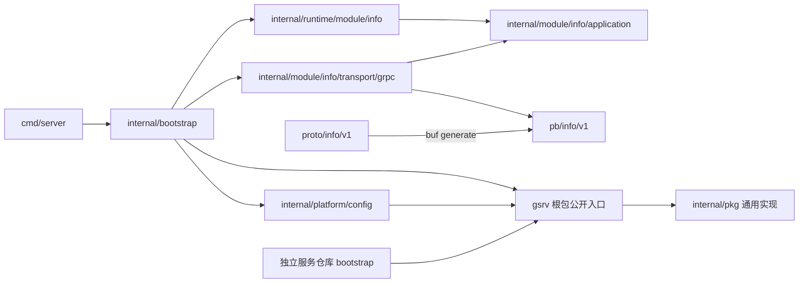
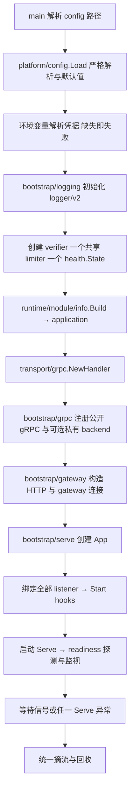
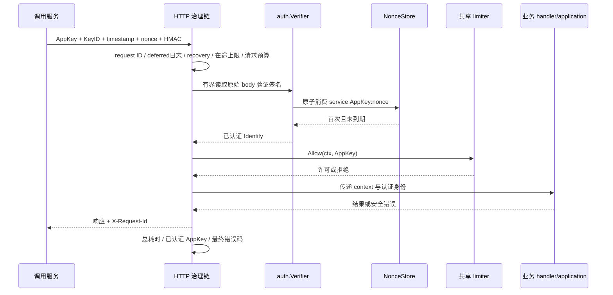
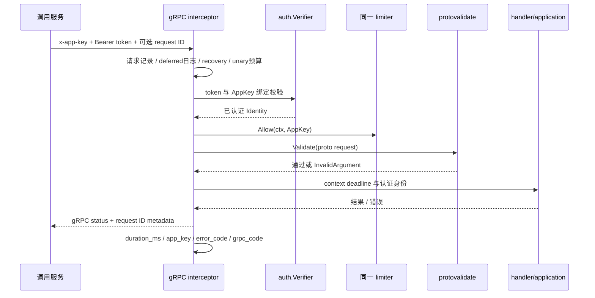
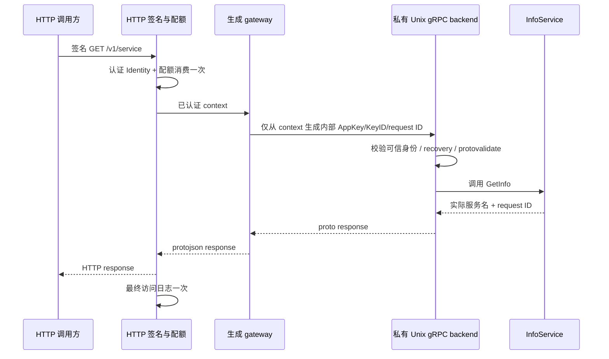
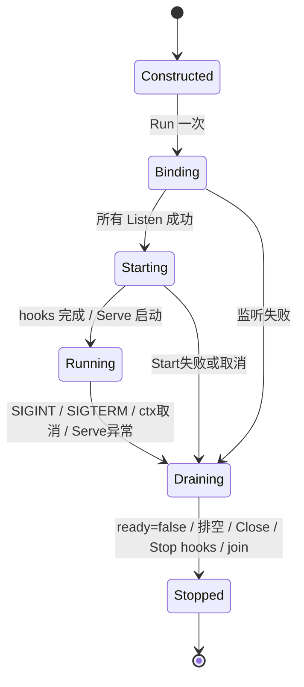

# gsrv 公共骨架实施方案

日期：2026-10-13。模块：`github.com/gtkit/gsrv`。部署背景：Linux 裸机单实例，无 Kubernetes、Docker 或注册中心。用户确认各中台服务使用独立 Go 模块、独立仓库；本轮交付公共骨架与独立模板。OCPC 按最新指令移除，以简单 InfoService 验证。真实 QPS、P99、请求大小与未来副本数尚未给出，下文配置是初始示例，不是容量承诺。

## 1. 架构约束与目录

**沿用参考项目 `ocpc-tool-service` 的目录层级与依赖方向。未经用户明确授权，不移动层级、不另设分层。** 删除 OCPC 不代表允许改变架构；`info` 在其原位置替代业务模块。通用实现位于已有 `internal/pkg` 层，根包只导出独立模块复用入口。

```text
gsrv.go                              公共装配入口，外部服务只 import github.com/gtkit/gsrv
cmd/server/main.go                   flag 与进程入口
config/env/env.yml.example           外置配置模板
proto/info/v1/info.proto             唯一契约源
pb/info/v1/                          buf 生成产物
internal/
  bootstrap/
    app.go                           配置→日志→入口服务→运行
    logging.go                       日志装配入口
    grpc.go                          runtime 模块→handler→gRPC 注册
    gateway.go                       HTTP/JSON 网关装配
    serve.go                         server 集合、运行和资源回收
  runtime/module/info/factory.go     模块装配
  module/info/
    application/info.go             中立服务信息查询
    transport/grpc/handler.go        proto/application 映射
  platform/config/config.go         服务配置默认值、校验与环境变量引用
  pkg/
    interceptor/                    unary/stream 治理链、错误映射
    requestid/                      request ID、认证身份记录与降级标记
    auth/                           HMAC、token 和 nonce 原子消费
    limiter/                        gtkit/golimit 适配
    logging/                        gtkit/logger/v2 装配和访问日志
    breaker/                        gobreaker/v2、httpc、降级执行钩子
    health/                         共享就绪状态与依赖检查
    lifecycle/                      Listen/Serve/Shutdown/Close 与信号
    httpserver/、grpcserver/         通用协议 server 封装
    gateway/                        生成 gateway 注册和身份 metadata
    configloader/                   严格单文档 YAML 与凭据环境变量读取
templates/service/                   独立模块，沿用上述服务分层
```

`repository → models`、`module/<m>/worker → application` 等原有层级规则继续有效；InfoService 没有持久化和后台任务，因此不生成空仓储、模型或 worker。未来实际业务需要这些能力时，仍放回原有层级。



禁止：application 引用 GORM、具体 repository、渠道 SDK 或熔断器；transport 引用 repository/GORM/SDK；repository、internal/pkg 反向依赖业务模块。公共入口和其 internal/pkg 实现不能引用根 InfoService、pb 或独立模板。架构传感器同时检查根服务和模板。

## 2. 范围与职责

| 能力 | gsrv 的职责 | 服务的职责 |
|---|---|---|
| 进程生命周期 | 信号、监听失败回收、摘流、排空、强制关闭 | 显式注册 servers/hooks，关闭自持资源 |
| 配置 | 严格 YAML、明确环境变量读取 | 在 platform/config 组合配置、补默认值、业务校验 |
| 服务注册 | 接收生成的 gRPC 注册函数，提供 HTTP handler 接口 | 注册本服务契约；下游地址从服务配置读取 |
| 健康检查 | /livez、/readyz、标准 gRPC Health，共用状态 | 注册少量必需依赖 Check |
| 服务调用方认证 | HTTP HMAC/token 校验与身份传递 | 提供凭据，处理终端用户与业务权限 |
| 限流 | 中立 `RateLimiter.Allow(ctx, AppKey)`、两协议共用 | 选择本地/外部实现与实际配额 |
| 熔断 | 指定下游的状态机、可配置失败分类 | 在 runtime adapter 中界定依赖和错误分类 |
| 降级 | allow/fallback 执行钩子、剩余预算、degraded 标记 | 决定是否允许降级、数据来源和结果 |
| 日志 | 请求 ID、耗时、已认证 AppKey、最终错误码 | 业务上下文日志与安全文案 |

服务注册中心当前不引入：同机/内网服务用静态地址和服务配置；gRPC 注册是进程内契约装配。未来需要动态发现时再按明确需求接入，不提前加入空 registry 抽象。验证码规则、推送路由、文件权限、身份授权等均不属于骨架。

## 3. 依赖复用

| 依赖 | 锁定版本 | 用途 |
|---|---|---|
| gtkit/logger/v2 | v2.3.0 | 唯一日志实现，显式控制台输出 |
| gtkit/encry | v1.3.0 | HMAC-SHA256 原语 |
| gtkit/golimit | v1.0.8 | 本地令牌桶 |
| gtkit/httpc | v1.5.0 | 有超时的出站 HTTP client |
| gtkit/json/v2 | v2.0.7 | 普通 HTTP 安全错误 JSON |
| grpc-go | v1.83.2 | server、health、metadata 与 status |
| grpc-gateway/v2 | v2.30.0 | proto HTTP/JSON 桥接 |
| buf.build/go/protovalidate | v1.2.0 | 统一 unary/RecvMsg 校验 |
| sony/gobreaker/v2 | v2.4.0 | gtkit 现有依赖没有提供所需熔断封装，新增状态机底座 |
| yaml.v3 | v3.0.1 | 既有严格配置加载 |

既有 gtkit 版本保持锁定，不升级 major；安全扫描确认后将 grpc-go 从 v1.83.0 升为修复版 v1.83.2、x/net 从 v0.57.0 升为 v0.60.0，并同步其所需 x/sys v0.48.0、x/text v0.42.0。修复依据见 [gRPC 官方漏洞记录](https://pkg.go.dev/vuln/GO-2026-6443)、[HTTP/2 官方漏洞记录](https://pkg.go.dev/vuln/GO-2026-6617)。

gobreaker/v2 是所用依赖的模块路径，不是将 gsrv 发版为 v2。公共骨架不强制数据库、Redis、消息队列。OCPC 专属 ocpcx、asynqx、redisx、asynq、go-redis、miniredis 已清理。未来实际需要 Redis/DB 时优先 gtkit/redisx、gtkit/ormx，仍由服务自身装配。

## 4. 组件装配流程



构造函数不启动背景 goroutine、不绑定监听。每个公开协议至少有认证器；空凭据不能用来关闭鉴权。HTTP/gRPC 使用同一 verifier、同一 limiter 和同一健康状态。InfoService 由 runtime 构造，handler 只映射服务名和框架注入的 request ID。

私有 gateway 连接由 bootstrap 持有，应用排空后关闭；日志最后 Sync。监听任一端口失败，已创建的 listener 回收，ready 保持 false。hooks 是显式后台组件；Start 即使部分失败也必须可 Stop，Stop 必须遵守总关闭 ctx。

## 5. 请求时序

### HTTP 原生 handler



认证失败不消耗调用方 QPS 配额。全局在途上限先于认证，以限制入口负载；触达该上限的请求尚未认证，日志 app_key 为空。探针不走业务认证/配额和访问日志。

### gRPC



stream 建连时认证与限流一次，每次 RecvMsg 校验；每连接并行 stream 上限独立生效。它不是逐消息 QPS 限流，也不把 unary 的 3s 自动施加到长期流；业务长连接的消息额度、最大生命周期与背压须单独设计。

### proto HTTP gateway



gateway 禁止把客户端 `Grpc-Metadata-*` 或内部身份头直接映射进 metadata；私有 backend 只能监听 Unix socket，父目录必须仅服务用户可访问（0700），socket 0600。公开 gRPC 始终验证 token，不信任私有身份头。单机部署使用独立系统用户保证进程隔离；持有相同系统用户权限的进程处于该信任边界内。

## 6. HTTP 签名契约

单值头：`X-App-Key`、`X-Key-Id`、`X-Signature-Timestamp`（Unix 秒）、`X-Signature-Nonce`、`X-Signature`（标准 Base64，严格编码）。服务名、AppKey、KeyID、nonce 均为 1–64 位 ASCII 字母、数字、点、下划线、短横线。secret 至少 32 字节，不发送到网络。

按以下顺序以换行拼接，末行后不补换行：

```text
gsrv-hmac-v1
目标服务名
AppKey
KeyID
HTTP method
URL.EscapedPath()（空则 /）
URL.RawQuery（保持原始顺序）
Content-Type（原值，未设置为空）
Unix 秒字符串
nonce
SHA256(原始 body) 的小写十六进制
```

计算 `Base64(HMAC-SHA256(secret, canonical))`，使用常数时间比较。校验原始字节后恢复 body，后续 JSON 解码不得先于签名。默认时间容差前后 30s，允许配置正值且不超过 5m；维护系统时钟同步。缺少、重复身份头、过期、篡改、method override 和重放均拒绝。

使用 `gsrv.SignHTTP(request, serviceName, credential, time.Now(), rand.Text())` 生成签名。每次重试用新 nonce；它不自动重试。按最终发往服务的 URI 签名，代理不得静默改写 path/query/content type/body。helper 限定 body 为 1MiB；大文件宜独立设计分片/对象存储直传与上传凭证，不将无限大内容读入内存。

内存 nonce store 默认容量 100000，不淘汰仍有效 nonce；满容量拒绝认证并返回 503。时间窗内同 AppKey 的 KeyID 轮换共享 nonce 域。单实例重启会丢失已消费记录；多副本也不会共享。需要跨重启/副本防重放时实现原子 `NonceStore.Use`，例如服务自身装配 redisx + 原子 SET NX TTL；本轮不引入无场景 Redis。

gRPC 使用绑定 AppKey 的 token 与 TLS；不对 protobuf 重新序列化后做同一 HTTP body 签名，以免出现规范化差异。token 可以按同 AppKey 多 KeyID 并行配置进行轮换；QPS 仍按 AppKey 汇总。

## 7. 限流、熔断与降级

本地限流适配锁定的 golimit v1：namespace + 已认证 AppKey，初始 burst=QPS。示例 QPS=100；缺省 0 明确关闭，负数非法。HTTP 与公开 gRPC 必须注入同一实例；更换 KeyID 不新增额度。达到限额 HTTP 429（配额拒绝带 Retry-After: 1）、gRPC ResourceExhausted；limiter 故障 fail-closed 为 503/Unavailable。

golimit v1 有进程全局 registry/清理 goroutine，没有实例 Close API；namespace 必须隔离服务/测试实例，生命周期按进程管理，不为新增 Close 升级 major。配额只在单进程共享，不宣称多副本全局额度。

每个外部依赖用独立 breaker，由 runtime adapter 持有。默认：统计窗口 30s、开启 10s、至少 20 个完成样本、失败比例 >=0.5、半开允许 1 请求。取消、参数错误、鉴权/权限拒绝不计依赖失败；业务通过 IsSuccessful/IsExcluded 补充领域分类。

`gsrv.RunDependency` 的 operation 与 fallback 共用正的总预算，不延长调用方 deadline，不自动重试。只有显式 `allow(err)` 为 true 且 fallback 非空才执行降级；取消、预算耗尽、鉴权与参数错误直接返回。fallback 内容归业务；成功降级标记 `degraded=true`。未提供 fallback 保留原错误，骨架不返回虚假的成功结果。`gsrv.NewHTTPClient` 复用 httpc 并要求正的客户端超时。

## 8. 生命周期与资源顺序



1. 绑定全部监听，开始后台组件；启动期间 ready=false。
2. 启动 Serve，执行关键依赖探测，监视器每 1s 同步标准 gRPC Health。
3. 收到关闭请求，立即 ready=false，取消监视器。
4. 从未取消的上下文创建**一个总关闭预算**，默认 20s。依注册顺序 HTTP → 公开 gRPC → 私有 gRPC，先让 HTTP 在途 gateway 调用完成。
5. HTTP Shutdown 超时强制 Close；gRPC GracefulStop 超时 Stop 并等待返回。
6. 取消后台 worker context，逆序 Stop hooks；等待 server/monitor goroutine 退出。
7. bootstrap 关闭自持 gateway 连接，最后 logger.Sync。

Start 在启动期须可取消并及时返回，Stop/Check/业务调用都必须遵守 ctx。Go 不能安全强杀不配合的任意业务函数；骨架不会为超时另起不受控 goroutine。App 不可并发/重复运行，需重新构造。致命错误在 main 收到清理后的返回值才记录，禁止 Serve goroutine 调 Fatal。

`/livez` 仅表示进程存活，不探测依赖。`/readyz` 看生命周期与关键依赖；每个 Check 上限 1s，失败不暴露依赖详情。gRPC Health 使用整体空服务名状态；依赖变化通过监视器同步。启动无强制 DB/Redis 探测，无依赖的 InfoService 可直接 ready。

## 9. 配置与日志核对

根服务与模板的 `config/env/env.yml.example` 使用同一字段定义和注释；实际 YAML 从模板复制，不保留 OCPC 的旧配置。缺失协议块关闭该协议，至少启用一个公开协议；不要用环境名称推断功能开关。

| 字段组 | 默认/回落 | 约束与作用 |
|---|---|---|
| name | 无默认，必填 | 服务名与 HMAC 目标必须一致 |
| shutdown_timeout | 0/缺省=20s | 正值，小于 systemd TimeoutStopSec |
| http.addr | 127.0.0.1:8080 | 非 loopback 需要成对 TLS 文件 |
| http.read_header_timeout/read_timeout | 5s/10s | 正值，限制入站读取 |
| http.write_timeout/idle_timeout | 15s/60s | 正值，write >= request_timeout |
| http.request_timeout | 3s | 合作式处理预算，不延长上游 deadline |
| http.max_body_bytes/max_inflight | 1MiB/100 | 正值，控制单体和入口并发 |
| grpc.addr/network | 127.0.0.1:9090 / tcp | tcp 或 unix；私有 backend 固定 unix |
| grpc.cert_file/key_file | 空 | 同时设置；跨主机 TCP 必填 |
| grpc.request_timeout | 3s | unary 预算，不施加到长期 stream |
| grpc.max_recv_bytes/max_send_bytes | 1MiB/1MiB | 正值，双向消息大小限制 |
| grpc.max_concurrent_streams | 100 | 每连接上限，非全进程/逐消息限流 |
| grpc.reflection | false | 调试服务，启用后仍走 stream 鉴权 |
| gateway_socket | 空关闭 | 非空要求 HTTP；私有父目录，路径相对 cwd |
| rate_limit_qps | 0 关闭 | 非负，每 AppKey 双协议合计本地配额 |
| keys.app_key/key_id | 必填 | 安全标识，同 AppKey/KeyID 不重复 |
| keys.secret_env/token_env | 无默认 | HTTP/公开gRPC 启用时相应必填，环境值至少32字节 |
| log.level/json | info/false | level 为 debug/info/warn/error；生产示例 JSON=true |
| log.path/console | 空/true | 文件路径空关闭文件；不可关闭所有输出 |

通用 AuthConfig 的时间窗、nonce 容量，以及 breaker 参数由显式代码装配设置；模板不为尚无场景的能力加入配置开关。

访问日志固定字段：`request_id`、`service`、`protocol`、`operation`、`duration_ms`、`app_key`、`error_code`、`degraded`，另带 `http_status` 或 `grpc_code`。error_code 统一大写下划线；grpc_code 保留协议原名。尚未认证时 app_key 为空，不信任伪造头。HTTP operation 优先 handler 路由 Pattern，缺失时记录 method+escaped path，不记录 query/body/token/secret/签名；不要在业务 URI path 中放凭据。日志使用 logger/v2 的上下文字段与显式 console 配置；配置非法/目录不可写在启动期报错。panic、配额拒绝、鉴权失败都输出最终访问记录；健康探针和私有 gateway backend 不重复记录。

## 10. 独立服务开发与 Linux 部署

根 InfoService 保留当前项目的完整分层，独立模板采用同样结构；新仓库只引用 gsrv 根包公开入口，不导入其 internal。模板的本地 replace 和 v0.0.0 只用于源码验证；正式使用选择真正发布版本，本轮不发布、不打 tag、不升级 gsrv 为 v2。

模板复制与改 module 步骤见 `templates/service/README.md`。更换 module 时只改手写 Go import 和 proto go_package，再 make gen，禁止直接改 pb。新增验证码/推送/文件/身份模块时：proto → application command/result/ports → runtime adapters → transport 映射 → bootstrap 注册；沿用原层级。

Linux/amd64 构建：`make build`。systemd 样例在 `templates/service/deploy/service.service.example`：独立用户、EnvironmentFile、RuntimeDirectory 0700、SIGTERM、30s 停机期限、失败重启、journald 控制台日志。实际配置使用 `/run/gsrv-service/gateway.sock`，远程地址需 TLS。样例需由部署负责人安装，本轮不修改用户级 systemd、不连接生产。

容量先以入口有界为目标：单请求 1MiB、同时100请求的原始 body 理论上限约100MiB，解析与桥接还会额外分配，需实测而非把该值当进程内存上限。实际容量估计使用 `并发≈QPS×平均耗时(秒)`；100QPS、平均100ms约10个在途请求。P99、慢依赖、上传场景须压测后决定预算/并发/配额，不把示例100当真实需求。不要同时放宽 body 与并发而忽略内存。

## 11. 实施与验收

| 阶段 | 实施内容 | 可观察验证 |
|---|---|---|
| 基线 | module/Go版本对齐，清理 OCPC 专属依赖 | go mod tidy、go build |
| 公共骨架 | 原 internal/pkg 位置实现 lifecycle/config/health | 监听失败回收、hooks、取消、探针、严格 YAML |
| 请求治理 | HMAC/nonce/token/limiter/request ID/errors/logs | 篡改/过期/重放、并发nonce、AppKey隔离、拒绝/panic日志 |
| 稳定性 | gtkit/httpc与gobreaker、显式降级钩子 | closed/open/half-open、失败分类、共享预算、取消无降级 |
| 服务验证 | 原层级 info 模块与同结构独立模板 | 实际 GetInfo HTTP/gRPC、返回真实服务名/request ID |
| gateway | 私有 socket 身份通道、配额一次 | 伪造客户端内部头无效、HTTP/gRPC同配额 |
| 交付 | 文档/配置/systemd/门禁同步 | make check、独立复制构建、Linux构建、漏洞检查 |

`make check` 包含 root 与模板的 build/lint/vet/race/go fix -diff/buf lint，根传感器检查两套层级。真实协议测试只在本机临时端口/socket，凭据为测试生成值；不触达媒体、DB、Redis 或生产。另做独立目录复制编译，证明模板不依赖当前 root 服务 internal；Linux 交叉编译验证目标平台。

OpenSpec 按任务记录执行并严格校验，完成后归档合并 spec。回滚是恢复本次源码、配置与依赖，不涉及持久化迁移。交付结果以实际检查日志为准；不可达的外部漏洞库须明确报告，不能将未完成扫描写为通过。
